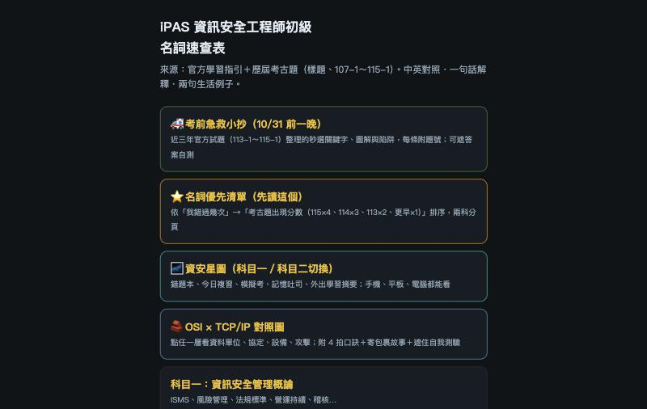
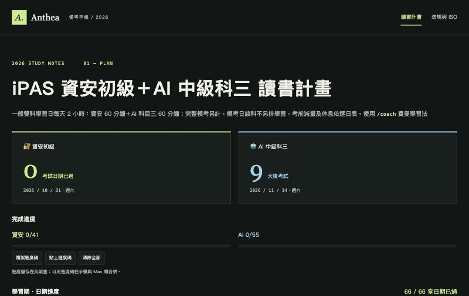
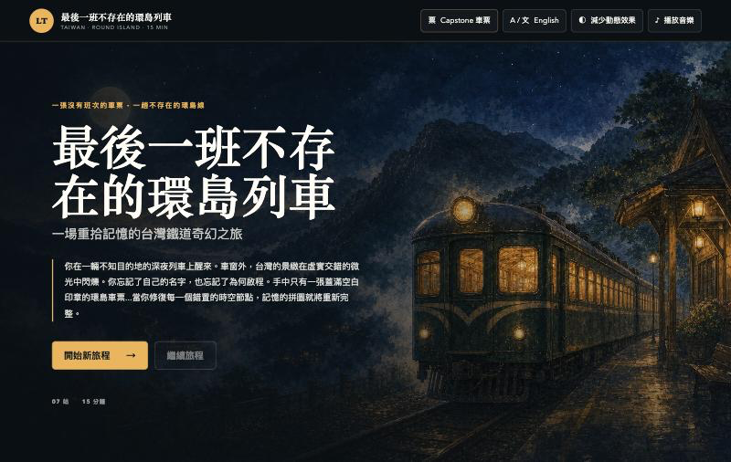
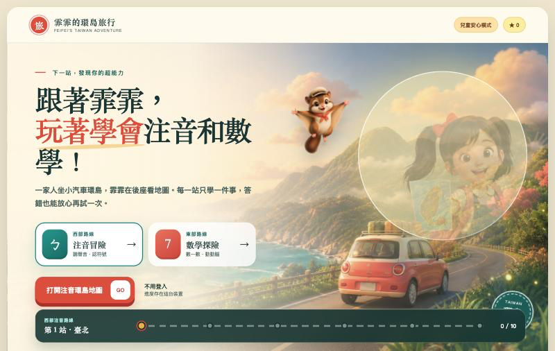
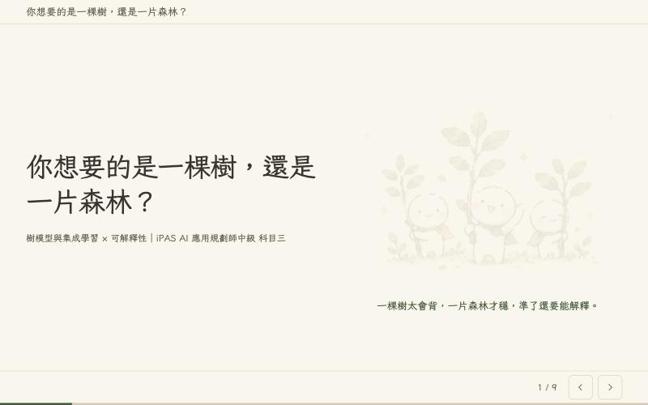
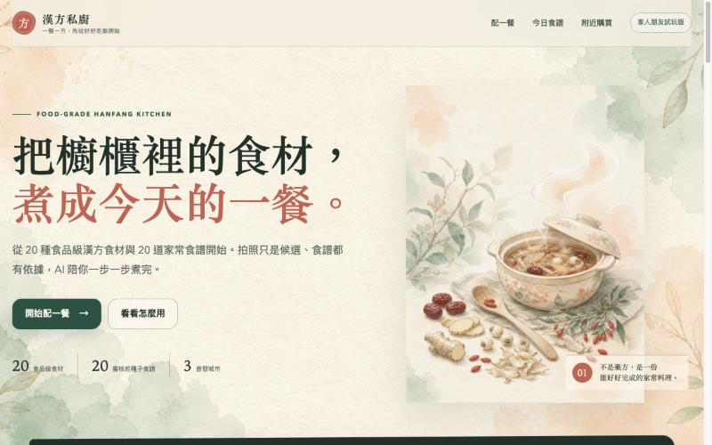

# Anthea Liu

我有經管背景，在半導體業從事 Sales Operation。2026 年起，以 AI 工具做資訊整理與學習工具，從自己的學習與生活需求出發，練習把問題變成可操作、可驗收的作品。

## 作品

| 名稱 | 這是什麼、解決什麼問題 | 我的角色 |
| --- | --- | --- |
| [iPAS 資安名詞速查表](https://anthea1003-bit.github.io/ipas-infosec-glossary/) | 把分散的資安名詞整理成手機可即時搜尋的卡片，方便讀書時查閱。 | 需求、規則、驗收與取捨 |
| [iPAS 讀書計畫與資安法規筆記](https://anthea1003-bit.github.io/ipas-exam-prep/) | 集中讀書計畫與法規筆記，減少備考時反覆翻找資料。 | 需求、規則、驗收與取捨 |
| [末班環島列車](https://anthea1003-bit.github.io/last-train-taiwan/) | 用中英雙語的臺灣旅行遊戲，讓玩家透過沿途選擇推進旅程。 | 需求、規則、驗收與取捨 |
| [霏霏的環島旅行](https://anthea1003-bit.github.io/feifei-adventure/) | 以環島闖關陪低年級孩子練習注音與數學，答錯也不扣分。 | 需求、規則、驗收與取捨 |
| [樹模型與集成學習讀書會簡報](https://anthea1003-bit.github.io/ipas-tree-ensemble-presentation/) | 用茶感微繪風插圖，說明樹模型、集成學習與模型判斷的解釋方式。 | 需求、規則、驗收與取捨 |
| [漢方私廚網頁原型](https://anthea1003-bit.github.io/hanfang-ai-private-chef/) | 依食材、過敏原與時間篩選示範食譜，試走選菜到陪煮的流程。 | 需求、規則、驗收與取捨 |

提出需求與規則、驗收結果、決定取捨；程式由 AI 工具（Codex／Claude）產生。

漢方私廚的食材、食譜與店家資訊仍是原型內容，尚待專業覆核與逐點查證。

## 畫面預覽

### iPAS 資安名詞速查表

### iPAS 讀書計畫與資安法規筆記

### 末班環島列車

### 霏霏的環島旅行

### 樹模型與集成學習讀書會簡報

### 漢方私廚網頁原型

## 開源貢獻

[QuotaGem PR #2](https://github.com/gyozalab/QuotaGem/pull/2)：新增 agy（Antigravity／Gemini）為第三個額度查詢來源，透過瀏覽器連線（CDP）取得額度；2026-06-19 已合併。

## 證照

- iPAS AI 應用規劃師中級
- iPAS 初級
- Microsoft AI-900
- ISO 27001:2022 與 ISO 27701:2019 內部稽核員

## 怎麼做作品

需求與驗收由本人訂定。  
程式交由 AI 工具（Codex／Claude）產生。  
每版由另一個 AI 模型審核後，再由本人裁決。
